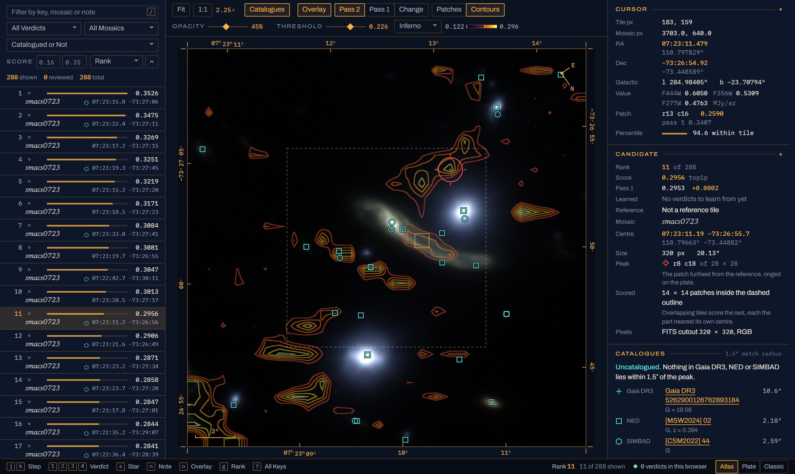
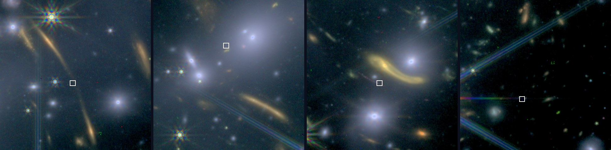
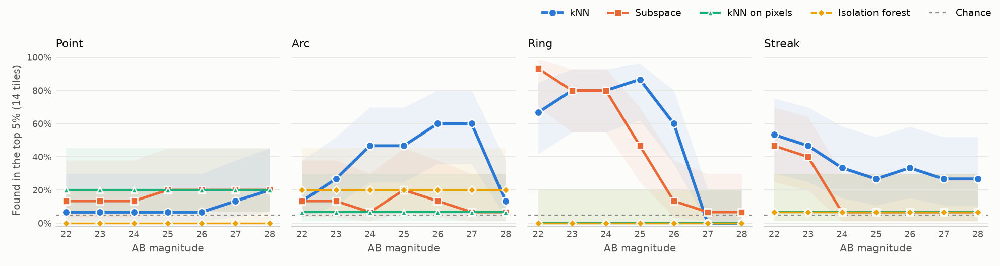

# jwst-peculiar

[](https://somethingobvious.github.io/jwst-peculiar/)

jwst-peculiar looks for strange things in James Webb Space Telescope (JWST) images without any labels. It cuts FITS mosaics into tiles, embeds them with a DINOv3 backbone, ranks every tile by how far its patches sit from ordinary sky, cross-matches the oddest spot in each with SIMBAD, NED and Gaia DR3, and opens the ranking in a web viewer that learns from your verdicts. It reads any FITS image with a WCS, so HST and Euclid work too.

The [demo](https://somethingobvious.github.io/jwst-peculiar/) is a real run on Webb's First Deep Field, the SMACS 0723 cluster in NIRCam F444W, F356W and F277W (program 2736 on [MAST](https://mast.stsci.edu/)), cut into 288 tiles. The screenshot is its 11th tile, where a lensed galaxy at a redshift of 6.27 is the third strongest of the 196 patches it scores.

## What It Finds



These are ranks 2, 3, 11 and 12. The top of the kNN ranking is mostly lensed arcs, the light of the cluster core and diffraction spikes, which come out as rainbows because the three filters' PSFs differ in width. The subspace detector finds different things, and the two barely agree (Spearman 0.19, with 3 tiles in both top 20s).

234 of the 288 tiles have nothing in any of the three catalogues within 1.5 arcseconds of their oddest patch. On a field this deep that mostly means galaxies too faint for them, so it's a filter to use with verdicts rather than a list of discoveries.

## Benchmark



`jwst-peculiar bench` plants points, arcs, rings and streaks of known AB magnitude in the FITS cutouts, blurred by STPSF's model of each filter's PSF, and renders them the way prep would have. On SMACS 0723, kNN finds half the planted rings down to AB 26.2. It finds 9 of 15 arcs at AB 26 and at 27, dropping below half past 27.2, but only 2 to 7 of 15 brighter ones, for a reason [the benchmark page](docs/benchmark.md#why-knn-finds-faint-arcs-more-often-than-bright-ones) explains. The same search on raw pixels finds almost none of them (14 of 315 arcs, rings and streaks against kNN's 133), and an isolation forest's ranking doesn't move with what is planted.

`jwst-peculiar recall` checks the 85 known lensed images in the field. Every detector ranks them above sky at the same distance from the core more often than chance (kNN at 64 where 50 is chance), though none clearly beats the others. [The benchmark page](docs/benchmark.md) has the numbers and caveats.

A LoRA fine-tune, trained so the same sky gives the same features wherever it falls in a tile, finds 1,475 planted sources to the default's 1,359 on 10 PRIMER-UDS visits it never saw (p = 0.008 over visits). [The model page](docs/model.md) has how it was chosen and where it doesn't help.

## Searches

Both searches were written down and pushed before any of their tiles were scored, and both came back empty. The pages list what changed in each plan after that.

COSMOS-Web scored 1,345 search tiles against 39,298 calibration tiles and named nothing at a false discovery rate of 0.1. The lowest p-value was 0.0018, and the injection check found that one badly rendered visit had capped what the search could see. [The search page](docs/search.md) has the plan and the result.

MINERVA, the medium-band survey, scored 514 tiles in 8 search blocks against 3,838 calibration tiles and named nothing either, with a lowest p-value of 0.006. The overlap and star rules emptied 17 of its 84 calibration blocks, which left too few calibration tiles for any one tile to pass alone (it would have taken two that beat every calibration tile), so an empty result says little here. A rescore afterwards on each tile's middle, which wasn't planned, named nothing either. The search also writes a colour list for people to look at. [The MINERVA page](docs/minerva.md) has the details.

## How It Works

The default detector scores each patch by its cosine distance to the nearest patch of a reference set, after [AnomalyDINO](https://github.com/dammsi/AnomalyDINO) (Damm et al., WACV 2025). The other scores its residual off a PCA subspace, after [SubspaceAD](https://arxiv.org/abs/2602.23013) (Lendering et al., 2026). With no labels, the reference comes from the tiles themselves in two passes, and a tile is never compared with one it overlaps.

Two systematics took over the top of the SMACS ranking before they were fixed at the source. Objects cut off by a tile's edge filled the outer ring of patches, so each patch now counts only for the tile whose centre it's nearest. Sky covered by one exposure instead of three took the top four places, so prep weights the flux by depth before rendering. [The method](docs/method.md) has the equations and the measurements.

`--reference_roots` scores against other fields instead and gives each tile a calibrated p-value, which needs fields with the same filters and a similar depth. Each tile also gets a descriptor built from its anomalous patches, and sorting by Learned in the viewer spreads your verdicts over them, so marking one diffraction spike as an artifact sinks the tiles that look like it.

## Install

```
python -m venv .venv
.venv\Scripts\activate        # or source .venv/bin/activate
pip install -e .
```

It needs Python 3.11 or newer. A CUDA GPU makes scoring a lot faster, but `--device cpu` works too (if pip picks the CPU build of torch, install the CUDA one from pytorch.org first). The viewer comes built, and only changing it needs Node.

The default backbone, `dinov3-vitl16-pretrain-sat493m`, was trained on satellite images, which are a lot closer to a mosaic tile than web photos are. Its weights are gated, so accept the licence on its Hugging Face page and run `hf auth login` once. `dinov2_vitl14` isn't gated.

## Usage

```
jwst-peculiar prep --files hst_10092_acs_wfc_f814w_drz.fits --out datasets/hst \
  --tile_size 320 --upscale 1 --stride 160 --wcs_in_name --save_cutouts
jwst-peculiar run --data_root datasets/hst --out_dir results --tag hst
jwst-peculiar match results_hst datasets/hst
jwst-peculiar view results_hst datasets/hst
```

`jwst-peculiar candidates` writes the ranking as a FITS or VOTable table with DS9 regions. [Usage](docs/usage.md) covers every command, the JWST colour presets and the thresholds worth knowing.

## What It Won't Do

Scores are only relative to the reference, so an artifact most tiles share counts as normal, and a rare thing can hide another like it if that one ends up in the reference. A lone point source looks like one more star and isn't found. Tiles that aren't fully covered are dropped, which leaves the sky within about a tile of the footprint's edge unexamined.

## Tests

```
pip install -e .[dev]
pytest
cd web && npm ci && npm test
```

Neither needs a GPU or downloaded weights, and CI runs both on every push to main.

## Licence

It's under the [PolyForm Noncommercial License 1.0.0](LICENSE.md). You can use it, change it and share it, forks included, for anything noncommercial like research or study. Commercial use isn't allowed.
