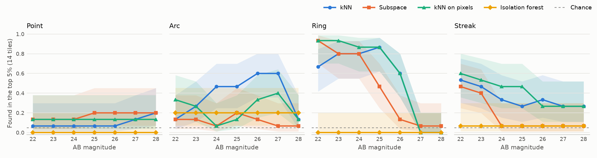

# Benchmark

There is no labelled set of JWST anomalies to score against, so there are two checks. `jwstdetector bench` plants sources of known brightness in real tiles and measures where they land in the ranking, and `jwstdetector recall` measures how a run ranks objects already known to be in the field. Everything here is from the 288 SMACS 0723 tiles of the demo.

## What Is Planted

Each run picks 12 tiles and adds one source to each, three points, three arcs, three rings and three streaks. The arcs, rings and streaks are half a pixel wide before the PSF, like a thin lensed arc or a satellite trail, and a ring or arc has a radius of 6 to 15% of the tile. A source gets a flat, red or blue spectrum ($f_\nu \propto \lambda^{\beta}$ with $\beta$ of 0, 2 or -2) and a total AB magnitude, which is its flux inside the tile at the filters' geometric mean wavelength.

The source goes into the tile's float FITS cutout, in the mosaic's own units (MJy/sr here, from `BUNIT`), blurred by each filter's PSF. For JWST that's STPSF's model of the filter on its detector, distortion included, turned to the mosaic's position angle. Laid over stars in SMACS 0723 and Abell 370, the model's spikes line up with theirs. Other telescopes get a Gaussian of the diffraction-limited width, and `--psf gaussian` forces that. The tile is then rendered back to its PNG with the exact stretch and noise weighting prep used, which reproduces every unplanted tile bit for bit. A seed fixes the tiles, shapes, positions and colours for every magnitude, so the curves differ by brightness alone. There are 5 seeds, so each point below is 15 sources of a kind, with a 95% Wilson interval.

A source counts as found when its tile ranks in the top 5%, the top 14 of 288. Real anomalies in the field compete with the planted ones, which is why it isn't first place, and the dashed line is the 5% a tile would reach by chance.

## Results



| | kNN | Subspace | kNN on pixels | Isolation forest |
|---|---|---|---|---|
| Arc, magnitude found half the time | 27.2 | never | never | never |
| Ring, magnitude found half the time | 26.2 | 24.9 | 26.2 | never |
| Arcs found, all magnitudes | 40 of 105 | 12 of 105 | 25 of 105 | 21 of 105 |
| All kinds found at AB 22 | 21 of 60 | 25 of 60 | 30 of 60 | 4 of 60 |
| All kinds found at AB 26 | 24 of 60 | 8 of 60 | 20 of 60 | 4 of 60 |
| All kinds found at AB 28 | 9 of 60 | 6 of 60 | 8 of 60 | 4 of 60 |

kNN on DINOv3 features finds the most arcs by far, and it keeps finding them to AB 27. On rings and streaks the same kNN search on raw 16 by 16 pixel patches does about as well or a bit better, so the backbone earns its place on extended, structured shapes rather than on everything. Over all kinds the two find 133 and 131 of 315 sources. The subspace detector finds bright rings and loses most things by AB 25. The isolation forest, on hand-built tile features the way Astronomaly scores images, stays at chance for every kind and magnitude.

Nothing finds point sources, at any brightness. A planted point is a blurred dot like the hundreds of faint galaxies and stars in every tile, and its rate stays flat at whatever share of the chosen tiles was in the top 5% before anything was planted.

With a Gaussian PSF in place of STPSF's, kNN finds half the arcs to AB 27.8 and half the rings to 26.6, so the real PSF costs about half a magnitude. The pixel baseline finds 152 of 315 with the Gaussian and kNN 161.

## Why kNN Finds Faint Arcs More Often Than Bright Ones

kNN finds 2 of 15 arcs at AB 22 and 9 of 15 at AB 26, and the cause is the bootstrap rather than the features. Each run plants three sources of each kind at the same magnitude, and when one of them ends up in pass 2's reference, the others match it and look ordinary. In an earlier set of Gaussian runs, a bright arc, ring or streak (AB 22 to 24) was found 68% of the time when no planted twin of it was in pass 2's reference and 23% of the time when one was, over 113 and 22 sources.

A real field can hold several of a rare thing too, like the lensed images of one galaxy around a cluster, so the same thing happens to real objects whenever the reference comes from the field itself. `--places N` is the direct fix. A patch then counts as ordinary only if it has close matches in N separate places on the sky, which a handful of twins can't fill. With 3 places, kNN found 115 of 189 sources on seeds 0 to 2, against 102, and the bright arcs, rings and streaks went from 52 to 63 of 81. On seeds 3 and 4, kept back to check the choice, it found 59 of 126 both ways, and the lensed images below ranked the same. That gain didn't hold up, so it isn't the default. 5 places did no better than 3.

## Real Lensed Images

`jwstdetector recall` takes the 85 lensed images of 30 background galaxies that Mahler et al. (2023) list in SMACS 0723 and measures where the patch at each one ranks among every patch the run scored. Positions in a lens model's catalogue are a pixel or two off and an image spans a few patches, so each image takes the highest distance within one patch of it, and every patch it is compared with gets the same treatment. (One declination in the published table reads -73.46170.5, which is taken as -73.461705.)

Lensed images crowd around the cluster core, which is unusual all over, so location alone does well on the usual figures. Ranking the tiles by nothing but their distance from the brightest cluster galaxy puts 31 of the images in the top 5% of tiles and gets an AUC of 0.91, better than any detector. So `--centre` compares each image only with patches at the same distance from the core, within 3 arcseconds, where 50 is chance. The interval comes from drawing whole lens systems, as the images of one galaxy aren't independent.

| | Same-radius percentile, mean (95%) | Tiles in the top 5% |
|---|---|---|
| kNN | 64.2 (57.6 to 70.9) | 30 of 85 |
| kNN, 3 places | 64.8 (59.0 to 70.5) | 30 of 85 |
| kNN on pixels | 68.5 (62.3 to 74.2) | 9 of 85 |
| Isolation forest | 61.2 (55.4 to 67.5) | 36 of 85 |
| Distance from the core only | 39.2 | 31 of 85 |

Every detector ranks a lensed image above the sky at the same radius more often than chance, and their intervals overlap. kNN minus the isolation forest is 3 points, with an interval of -3.4 to 9.3. Most of these images are faint galaxies that look like any other faint galaxy, so a detector of the unusual rightly passes over many of them, and this measures what it finds among them rather than completeness.

## Backbones

The same kNN run on each DINOv3 checkpoint, with the planted sources under a Gaussian PSF.

| Backbone | Arc, half found at AB | Ring, half found at AB | Lensed images, same-radius percentile |
|---|---|---|---|
| ViT-L/16, SAT-493M (default) | 27.8 | 26.6 | 64.2 (57.6 to 70.9) |
| ViT-7B/16, SAT-493M | never | 26.2 | 53.2 (45.4 to 61.4) |
| ViT-L/16, LVD-1689M | 25.7 | 25.8 | 44.2 (38.1 to 50.3) |
| ViT-H+/16, LVD-1689M | 25.5 | 25.5 | 45.8 (40.2 to 51.3) |

The satellite weights beat the web-photo ones at both sizes, and the 7B model is worse than the large one on the same data. It doesn't fit in 8 GB, so it runs streamed, one layer at a time from disk, at about 2.4 tiles a second.

## Removing Directions

`--drop_directions N` takes the top N principal directions out of the patch features before the kNN search, on the idea that the strongest directions are what every tile shares. It hurts. Dropping 1 cut the lensed images in the top 5% from 30 to 13 and lost every arc, and dropping 8 left 1.

## What It Doesn't Show

- Only the planted tile is changed. The overlapping tiles that also hold that bit of sky don't see the source, and part of a big ring can fall outside the area its tile scores.
- The stretch is fixed per mosaic, so at AB 22 the core of a ring or arc saturates the rendered tile.
- These are recalls for sources added to SMACS 0723. A field with a different depth, crowding or mix of real anomalies will give different curves, and `jwstdetector bench` on that field is the way to find out.

## Running It

```
jwstdetector bench --data_root datasets/smacs_nircam --out_dir bench --mags 22 23 24 25 26 27 28 --seeds 5 \
  --detectors knn subspace pixels iforest
jwstdetector recall results_smacs datasets/smacs_nircam --objects lensed.csv --centre 110.8270 -73.4541
```

The bench writes `injections.csv` with every planted source's rank, `summary.csv` with recall and its interval per detector, kind and magnitude, and `completeness.png`. The 140 runs here took 42 minutes on a laptop RTX 4070, as each embeds only the tiles that changed. STPSF comes with `pip install -e .[webb]` and needs its data files, which its documentation explains how to fetch.

## References

- Mahler et al. Precision Modeling of JWST's First Cluster Lens SMACS J0723.3-7327. ApJ 945, 49, 2023.
- Perrin et al. Updated Point Spread Function Simulations for JWST with WebbPSF. Proc. SPIE 9143, 2014.
- Liu, Ting, Zhou. Isolation Forest. ICDM 2008.
